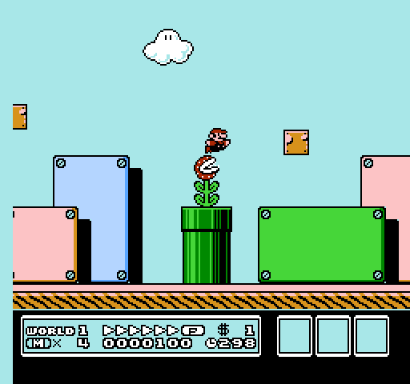
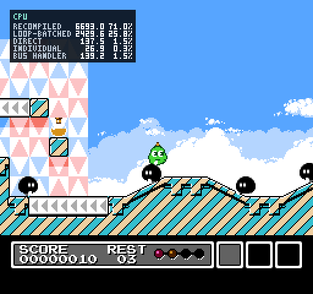
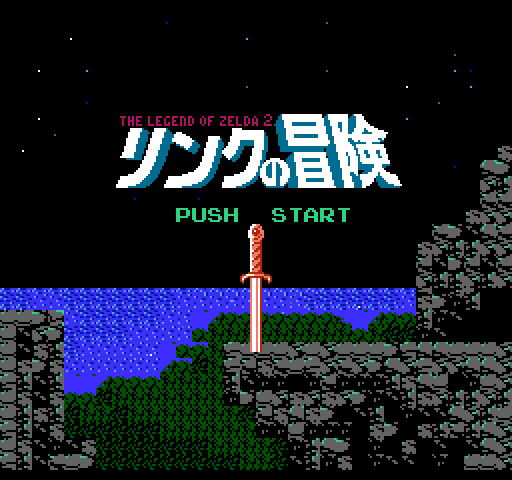
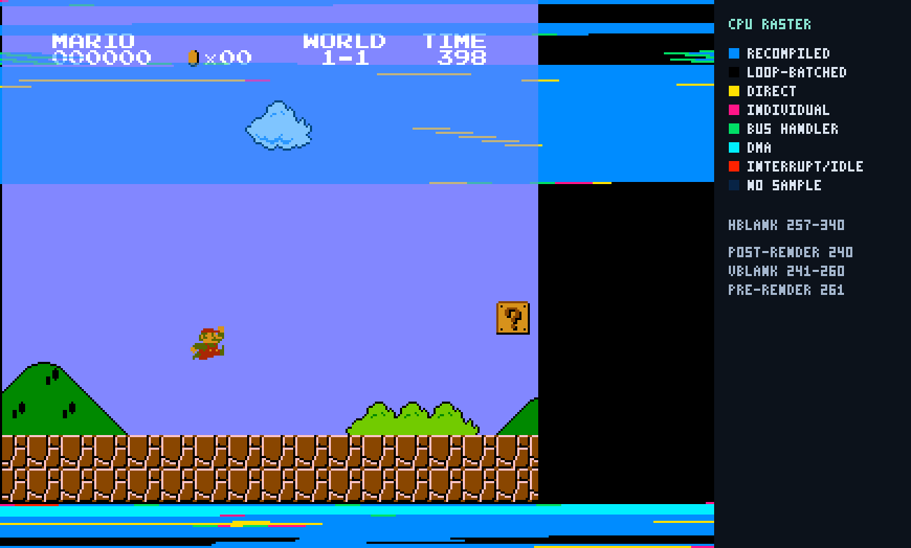

# SchNES

SchNES is a simple and highly-performant NTSC NES and FDS emulator for macOS
and Windows, optimized for Arm processors.

On an Apple M3 MacBook Air, SchNES runs at 800 to 4,500× real-time speed
with reasonable emulation accuracy.

| Super Mario Bros. 3 | Gimmick! (with CPU stats) | The Legend of Zelda 2 (FDS) |
| --- | --- | --- |
|  |  |  |

## Controls

| NES control | Player 1 | Player 2 | SDL gamepad |
| --- | --- | --- | --- |
| D-pad | Arrow keys | W A S D | D-pad or left stick |
| A | X | G | South button |
| B | Z | F | West or east button |
| Select | Right Shift | Left Shift | Back |
| Start | Enter | Tab | Start |

## Build and run

Requires a C11 compiler, CMake 3.16 or later, and SDL2. Build and run from this
directory:

```sh
cmake -S . -B build -DCMAKE_BUILD_TYPE=Release
cmake --build build --parallel
./build/SchNES "game.nes"
```

Double-click `SchNES` (or `SchNES.app` on macOS) and drag a ROM onto the window.

### Hotkeys

| Key | Action |
| --- | --- |
| **Backtick** (`` ` ``) | Hold to run the game uncapped with audio muted |
| **1** | Cycles through the statistics overlay pages |
| **2** | Cycles through regular, ultrafast, and interpreter mode |
| **3** | Toggles the 256×224 crop |
| **4** | Cycles runahead through one frame, off, and two frames |
| **5** | Toggles No-Lag mode |
| **6** | Toggles the eight-sprite-per-scanline display limit |
| **7** | Toggles the CPU raster debugger |
| **8** | Saves a PNG of the current view, including overlays |
| **-** | Ejects the Famicom Disk System disk, or inserts it again |
| **=** | Switches to the next disk side |
| **P** | Pauses the game |
| **R** | Resets the game |
| **F11** | Toggles fullscreen |
| **Esc** | Quits |

### Options

| Option | Effect |
| --- | --- |
| `-u` | Enables ultrafast emulation |
| `-i` | Starts in interpreter mode |
| `-s` | Draws all sprites on each scanline |
| `-n` | Starts in No-Lag mode |
| `-f` | Shows the full 256×240 view |
| `-r` | Disables runahead |

## CPU raster debugger

Press **7** to overlay CPU activity on the game and see when it happens across
the full frame.



The sidebar explains the raster colors. They show how SchNES executed
instructions and when DMA, interrupt handling, or idle cycles occurred.
The view shows the committed frame and its CPU activity.

The debugger maps CPU activity to a **341×262 grid of PPU dots**. The picture
occupies rows **0–239**, with horizontal blanking to its right and post-render,
vblank, and pre-render below. No-Lag adds 100 post-render rows for a **341×362**
grid.

## Game speed

Uncapped core FPS measured on an Apple M3 MacBook Air using SchNES and QuickNES 1.0-WIP (26bb785).

| Game | Regular FPS | Ultrafast FPS | Interpreter FPS | QuickNES FPS | Regular vs QuickNES |
| --- | ---: | ---: | ---: | ---: | ---: |
| Super Mario Bros. | 143,603 | 147,555 | 66,872 | 21,567 | 6.66× |
| Super Mario Bros. 2 | 169,102 | 180,381 | 89,449 | 23,308 | 7.26× |
| Super Mario Bros. 3 | 86,935 | 104,327 | 41,427 | 18,757 | 4.63× |
| Balloon Fight | 267,511 | 275,882 | 150,677 | 23,530 | 11.37× |
| Battletoads | 112,566 | 114,926 | 51,932 | 22,140 | 5.08× |
| Castlevania III | 115,178 | 131,229 | 68,697 | 21,858 | 5.27× |
| Castlevania III (Japan) | 81,297 | 99,848 | 57,116 | 21,592 | 3.77× |
| Double Dragon II | 169,930 | 171,710 | 62,692 | 20,253 | 8.39× |
| Gimmick! | 72,186 | 79,839 | 50,400 | 20,891 | 3.46× |
| Gradius II | 52,668 | 73,047 | 37,767 | 19,013 | 2.77× |
| Kirby’s Adventure | 94,643 | 106,914 | 48,540 | 18,695 | 5.06× |
| Kung Fu | 156,967 | 176,480 | 63,492 | 22,453 | 6.99× |
| Little League Baseball | 84,256 | 86,857 | 49,735 | 21,033 | 4.01× |
| Mach Rider | 55,560 | 57,119 | 33,494 | 20,317 | 2.73× |
| Marble Madness | 134,084 | 136,773 | 77,289 | 22,554 | 5.95× |
| Mega Man 3 | 127,979 | 130,802 | 57,243 | 19,710 | 6.49× |
| Micro Machines | 101,601 | 102,834 | 49,396 | 19,148 | 5.31× |
| MiG 29: Soviet Fighter | 64,705 | 78,764 | 38,743 | 15,867 | 4.08× |
| Mike Tyson’s Punch-Out!! | 188,942 | 200,207 | 134,034 | 23,470 | 8.05× |
| Slalom | 103,062 | 104,586 | 49,570 | 19,743 | 5.22× |
| Super Mario Bros. 2 (FDS) | 119,450 | 123,318 | 61,549 | — | — |
| Zelda II (FDS) | 73,222 | 77,784 | 55,825 | — | — |

**Note:** QuickNES lacks FDS support.

## Famicom Disk System

SchNES supports `.fds` disk images. Place the FDS BIOS (`disksys.rom`), beside
the disk image or SchNES. Disk writes are saved beside the image as
`game.fds.sav`. SchNES will try to change disks automatically when the game
asks for it. Alternatively, use **-** and **=** to change disks by hand.

## Statistics overlay

Press **1** to cycle through Info, CPU statistics, raster statistics,
and hidden. The CPU and raster pages update every 60 emulated frames
and show averages and percentages per frame.

### Info

- **Emulation FPS** counts committed emulation frames per second
- **Display FPS** counts new gameplay frames presented to the visible window
  each second (excluding skipped and runahead frames)
- **Mapper** shows the cartridge's mapper number and family name
- **PRG/CHR ROM**, **External SRAM** and **CHR RAM** show the loaded
  cartridge's program/graphics ROM, external program RAM, and writable
  graphics RAM sizes

### CPU statistics

- **Recompiled** counts instructions executed by native blocks in Regular and
  Ultrafast, including blocks reached through native links
- **Loop-Batched** counts instructions from compiled loops, polling loops, and
  countdowns, as well as batched CHR-RAM uploads
- **Direct** counts instructions completed by the fast dispatcher between
  hardware events
- **Individual** counts instructions stepped by the timing interpreter
- **Bus Handler** counts instructions started by the fast dispatcher and
  completed by the shared bus handler

### Raster statistics

- **Sections** totals Regions, Single Lines, and Redraws
- **Regions** counts batches of consecutive scanlines
- **Batched Lines** counts scanlines processed in regions
- **Single Lines** counts scanlines processed individually
- **Redraws** counts extra rendering passes over all or part of a scanline
- **Total Syncs** adds PPU Syncs and APU Syncs
- **PPU Syncs** counts calls to bring the PPU up to a CPU cycle, including
  calls that only update the raster position or check pending events
- **APU Syncs** counts calls to bring the APU up to a CPU cycle, including
  calls that fetch several streamed DMC bytes or leave the APU clock unchanged
  in a No-Lag pause
- **Bus Reschedules** counts full recalculations of the CPU fast-path deadline

## Supported mappers

SchNES loads iNES and NES 2.0 cartridge images for NTSC NES hardware.

| ID | Mapper family | Submappers |
| ---: | --- | --- |
| 0 | NROM | 0 |
| 1 | MMC1 | 0, 1, 2, 4, 5 |
| 2 | UxROM | 0, 1, 2 |
| 3 | CNROM | 0, 1, 2 |
| 4 | MMC3, MMC6, MC-ACC | 0, 1, 3, 4 |
| 5 | MMC5 | 0 |
| 7 | AxROM | 0, 1, 2 |
| 9 | MMC2 | 0 |
| 10 | MMC4 | 0 |
| 21 | Konami VRC4a, VRC4c | 0, 1, 2 |
| 22 | Konami VRC2a | 0 |
| 23 | Konami VRC2b, VRC4e, VRC4f | 0, 1, 2, 3 |
| 24 | Konami VRC6a (with VRC6 audio) | 0 |
| 25 | Konami VRC2c, VRC4b, VRC4d | 0, 1, 2, 3 |
| 26 | Konami VRC6b (with VRC6 audio) | 0 |
| 66 | GxROM | 0 |
| 69 | Sunsoft FME-7, 5A, 5B (with 5B audio) | 0 |
| 71 | Camerica BF9093, BF9097 | 0, 1 |
| 206 | Namco 108 (DxROM) | 0, 1 |

## Headless mode

Headless mode runs at an uncapped frame rate and renders each emulation frame
at full size while generating audio samples.

```sh
./build/SchNES --headless 3000 "game.nes"
```

## Other build options

Note: these instructions were written from the perspective of a macOS user.
Some adjustments might be needed if you don't need cross-compiling.

### Windows x64 with shared SDL2

Put LLVM-MinGW and Ninja on `PATH` and use the `x86_64-w64-mingw32` files
from the [SDL2 MinGW development package](https://github.com/libsdl-org/SDL/releases/download/release-2.32.10/SDL2-devel-2.32.10-mingw.zip).
Set `SDL2_DIR` to the directory containing `SDL2Config.cmake` or
`sdl2-config.cmake`.

```sh
cmake -S . -B build-x64 -G Ninja --toolchain cmake/WindowsX64.cmake \
  -DCMAKE_BUILD_TYPE=Release -DSDL2_DIR="/path/to/x64-sdl2/lib/cmake/SDL2"
cmake --build build-x64 --target SchNES --parallel
```

Copy the x64 `SDL2.dll` beside `build-x64/SchNES.exe` before launching.
This release build uses the portable CPU execution path and has PGO off by default.

### Static SDL build

Use an SDL2 installation that exports the `SDL2::SDL2-static` CMake target.
Set `SDL2_DIR` to that installation's CMake package directory if CMake selects
a different installation.

```sh
cmake -S . -B build-static -DCMAKE_BUILD_TYPE=Release -DSCHNES_STATIC_SDL=ON
cmake --build build-static --parallel
```

On macOS, the linker drops unused code and direct framework dependencies when
SDL2 is linked statically. The app is available at `build-static/SchNES.app`.

#### Lean static build

With CMake 3.24 or later, use the official [SDL2-2.32.10.tar.gz release archive](https://github.com/libsdl-org/SDL/releases/download/release-2.32.10/SDL2-2.32.10.tar.gz)
and pass its path as `SCHNES_SDL2_ARCHIVE`. CMake verifies the archive and
applies the shared SDL2 profile on macOS and Windows.

```sh
cmake -S . -B build-lean -DCMAKE_BUILD_TYPE=Release \
  -DSCHNES_SDL2_ARCHIVE="$PWD/build/SDL2-2.32.10.tar.gz"
cmake --build build-lean --config Release --target SchNES --parallel
```

For Windows, put the LLVM-MinGW toolchain's `bin` directory on `PATH`. Use
`-G Ninja --toolchain cmake/WindowsArm64.cmake` for ARM64 or
`-G Ninja --toolchain cmake/WindowsX64.cmake` for x64. Use a separate build
directory for each target.

### Lean static PGO build for Windows x64

With the SDL2 archive and the local gameplay replay corpus in `build/`,
run the x64 build on Windows or on a host with Wine.

```sh
python3 scripts/publish.py --windows-x64
```

Use `--mingw-bin` or `--wine` if needed to specify tool paths. The script
trains the x64 build and writes the executable to
`build/publish/windows-x64/SchNES.exe`. See [build inputs](scripts/README.md#release-builds).

## Development notes

Code was mostly written by Claude Opus 5.5 and GPT 6.2 Sol. A human
verified/critiqued their work and gave them ideas/directions throughout the
development process.

By now, LLMs can regurgitate a decent NES emulator implementation trivially.
That's not fun though; it's better to push them to the limits by implementing
increasingly more advanced optimization concepts so the emulator can offer a
compelling gimmick (in this case: super-fast emulation).

## Implementation details

### Hardware

**CPU** batches instructions between hardware deadlines and uses cycle-timed
execution near them. Regular and Ultrafast recompile hot ROM and RAM code on
supported ARM64 builds and fall back to the interpreter when native code is
unavailable. When an FDS game modifies code in RAM, SchNES discards the affected
compiled traces, including during runahead.

**PPU** batches elapsed scanlines and reuses cached background rows with ARM64
SIMD where available. Regular and Interpreter retain NES color and emphasis
bits until display. Ultrafast produces RGB565 and can batch eligible scroll
writes across raster events when scanline IRQs are inactive. Unusual OAM
addresses and sprite-height changes use secondary OAM evaluation. Mid-scanline
changes are approximated.

**APU** uses 48 kHz fixed-point mixing in all modes. Regular and Interpreter
preserve DMC stall lengths. Ultrafast can stream eligible DMC samples between
CPU-visible events, which can change timing for recordings that depend on
stalls. Streaming covers banked cartridge ROM and fixed FDS BIOS samples.
Reads from writable program memory and the final IRQ-producing fetch use the
CPU bus. SchNES renders Sunsoft 5B, VRC6, and FDS audio separately and mixes it
with the main APU output at the end of each emulated frame.

**Mapper timing** uses the next IRQ as a CPU deadline. Register writes stay in
the current batch when their effects allow it. The bus handler processes writes
that require a handoff.

**Write classification** in `src/write_effects.h` describes what each write can
change. `apu_write_effects` covers `$4000`-`$4017`: waveform writes only change
the sound, and DMC and frame counter writes leave the batch when they can move
a CPU event or the IRQ line, follow a due streamed DMC read, or end No-Lag lines
for PCM streaming.
`src/ppu_writes.h` covers `$2000`-`$2007` per mode and write cycle: NMI changes
and accesses that can clock a scanline IRQ leave the batch, and raster inputs
apply at their dot, after timed mask, scroll deferral or address sync policies.

### No-Lag mode

No-Lag adds 100 blank scanlines and scales the CPU and PPU clocks to keep
60.10 Hz. It preserves the NTSC dot count from vblank NMI to the picture.
The APU and expansion audio pause during the extra lines to preserve pitch
and DMC-driven splits. Ultrafast keeps DMC streaming enabled by scheduling
fetches on the CPU clock and mixing on the paused APU clock.
CPU-timed mapper IRQs and FDS transfers follow the faster CPU clock.

High-rate `$4011` PCM streams use NTSC-length frames. Eligible `$2002` timing
probes can skip the extra interval, preserving NTSC detection in games such
as MiG 29.

### Famicom Disk System

Side A is inserted at power-on. SchNES uses BIOS disk IDs to select the
requested side and simulates ejection and reinsertion when games wait for a
side change.

### Mappers

**VRC2/VRC4** uses VRC4 with both iNES register wirings for submapper 0.
Submapper 3 selects VRC2, including its `$6000` latch when no PRG RAM is declared.

**MMC3/MMC6** uses MMC3 RAM protection for iNES images until the game issues
the MMC6 enable sequence. NES 2.0 submapper 1 selects 1 KiB of MMC6 RAM with
per-half permissions. Submapper 4 selects the NEC MMC3, which suppresses IRQs
when its counter automatically reloads from zero to zero.

**VRC6** uses console nametable RAM and approximates other layouts with
horizontal, vertical, or one-screen mirroring.

**MC-ACC** approximates falling A12 edges four dots early, using sprite
fetches with sprites at `$1000` and background tiles at `$0000`.
